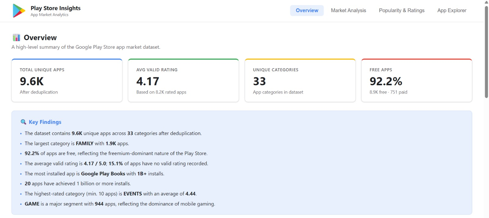

# Google Play Store Insights App Market Analytics Dashboard

An interactive data analytics dashboard designed to explore the Google Play Store app market, uncover category-level patterns, and analyze application popularity and ratings.

## Project Overview

The **Google Play Store Insights App Market Analytics Dashboard** transforms raw Google Play Store application data into interactive visualizations and meaningful market insights.

The dashboard enables users to explore application categories, compare ratings, examine installation and review patterns, and investigate individual applications through an interactive data table.

Developed as part of the capstone project **Data AI Agent for Data Analysis program with Hacktiv8**, with **IBM Bob** used as an AI coding assistant.

## Dashboard Preview

The dashboard consists of four main sections, each designed to support a different aspect of app market exploration.

### 1. Overview



Provides a high-level summary of the Google Play Store app market through key performance indicators (KPIs), application distributions, rating patterns, and data-driven insights.

### 2. Market Analysis


Compares application categories by app count and average rating to help users identify category-level patterns and differences.

### 3. Popularity & Ratings


Explores application popularity through reported installation brackets, review volumes, rating distributions, and relationships between application characteristics.

### 4. App Explorer


Provides an interactive data table for searching, filtering, sorting, and exploring application-level information.

## Key Features

- **Market Overview:** Presents key metrics and an overview of the app market.
- **Category Analysis:** Compares app counts and average ratings across categories.
- **Popularity Insights:** Explores reported installation figures and review volumes.
- **Rating Analysis:** Examines rating distributions and application-level rating patterns.
- **Interactive App Explorer:** Enables users to search, filter, sort, and inspect individual applications.
- **Dynamic Data Processing:** Calculates metrics and generates visualizations from the loaded dataset.
- **CSV Data Loading:** Supports automatic local dataset loading and CSV upload as an alternative.
- **Interactive Visualizations:** Presents data through charts and graphical summaries.
- **Clean Interface:** Uses a white dashboard layout inspired by Google Play's visual identity.

## Dataset

**Source:** [Google Play Store Apps Dataset — Kaggle](https://www.kaggle.com/datasets/lava18/google-play-store-apps)

The project uses `googleplaystore.csv` as its primary data source.

The dataset contains application-level attributes, including:

| Variable | Description |
| --- | --- |
| App | Application name |
| Category | Application category |
| Rating | User rating |
| Reviews | Number of reviews |
| Size | Reported application size |
| Installs | Reported installation bracket |
| Type | Free or paid |
| Price | Application price |
| Content Rating | Intended audience classification |
| Genres | Application genre |
| Last Updated | Last update date |
| Current Ver | Current application version |
| Android Ver | Required Android version |

The separate user-review dataset is not used in this project. Sentiment analysis and machine learning are outside the scope of this dashboard.

## Data Processing

Before calculating metrics and rendering visualizations, the dashboard processes the source data to improve consistency and analytical reliability.

Key data preparation steps include:

- Parsing installation counts and review counts into usable numeric values.
- Processing application prices and sizes.
- Handling missing and invalid ratings appropriately.
- Investigating duplicate records.
- Identifying malformed records where possible.
- Distinguishing unique applications from raw dataset rows.
- Avoiding duplicate counting in summary metrics.
- Calculating metrics and insights from the loaded dataset instead of hardcoding results.

Installation brackets such as `1,000,000,000+` and `500,000,000+` represent reported minimum thresholds, not precise installation totals.

## Technology Stack

- **HTML5** — Dashboard structure.
- **CSS3** — Styling, layout, and responsive design.
- **JavaScript** — Data processing, interactivity, and visualization logic.
- **CSV** — Primary data source.
- **Python 3** — Lightweight local HTTP server for reliable automatic dataset loading.
- **GitHub** — Source code version control and project repository.

## Design Approach

The dashboard uses a clean, white interface inspired by Google Play's visual identity.

| Element | Color |
| --- | --- |
| Primary blue | `#4285F4` |
| Green accent | `#34A853` |
| Yellow accent | `#FBBC04` |
| Red accent | `#EA4335` |
| Background | `#FFFFFF` |
| Primary text | `#202124` |
| Secondary text | `#5F6368` |
| Borders | `#DADCE0` |

The design emphasizes readability, consistent spacing, clear visual hierarchy, and intuitive navigation. The color palette helps distinguish chart elements and maintain a consistent appearance across dashboard sections.

## Project Structure

```text
Google-Play-Store-Insights_App-Market-Analytics-Dashboard/
├── index.html
├── googleplaystore.csv
├── google-play-logo.png
├── start-server.bat
├── Overview.jpeg
├── Market Analysis.png
├── Popularity & Ratings.png
├── App Explorer.png
└── README.md
```

## How to Run the Dashboard

### Prerequisites

- A modern web browser.
- Python 3 installed on your computer for the local server method.

### Option 1: Run Using the Local Server

1. Clone or download this repository.
2. Extract the project files if you downloaded a ZIP archive.
3. Open the project folder.
4. Run `start-server.bat`.
5. Wait for the local server to start.
6. Open the local URL displayed in the terminal in your web browser.

Make sure `index.html` and `googleplaystore.csv` remain in the expected project directory so the dashboard can load the dataset correctly.

### Option 2: Open the HTML File Directly

1. Open the project folder.
2. Double-click `index.html` to open it in your browser.
3. If automatic CSV loading is blocked by browser security restrictions, use the local server method or the CSV upload option provided by the dashboard.

## Analytical Scope

This project focuses on exploratory data analysis of Google Play Store applications. The dashboard supports exploration of:

- Application distribution across categories.
- Differences in average ratings between categories.
- Reported installation figures and review volumes.
- Rating distributions and application popularity.
- Application-level attributes through interactive search and filtering.

The dashboard is intended for descriptive and exploratory analysis. Observed patterns and associations should not be interpreted as evidence of causal relationships.

Installation values are reported in brackets in the original dataset, so converted figures may be approximate. Ratings, review counts, and other metrics should also be interpreted in the context of the source data's limitations.

## Project Objectives

- Practice data cleaning and exploratory data analysis.
- Develop interactive data visualizations using web technologies.
- Transform raw application data into accessible visual insights.
- Build a practical data analytics portfolio project.
- Explore the use of AI-assisted coding during dashboard development.

## Limitations

- The analysis depends on the quality and completeness of the source dataset.
- Reported installation brackets do not provide exact installation counts.
- Missing, invalid, or duplicated records may affect some metrics if not handled appropriately.
- The dashboard is descriptive and does not establish causal relationships.
- Sentiment analysis and machine learning are not included in the project.

## Author

**Regina Adelisa**

Data Analytics Portfolio

- **GitHub:** [reginaadelisa](https://github.com/reginaadelisa)
- **Portfolio:** [View Portfolio](https://sites.google.com/view/portofolio-reginaadelisa/beranda)

---

*Developed as part of the Data AI Agent for Data Analysis capstone program with Hacktiv8, with IBM Bob used as an AI coding assistant.*
